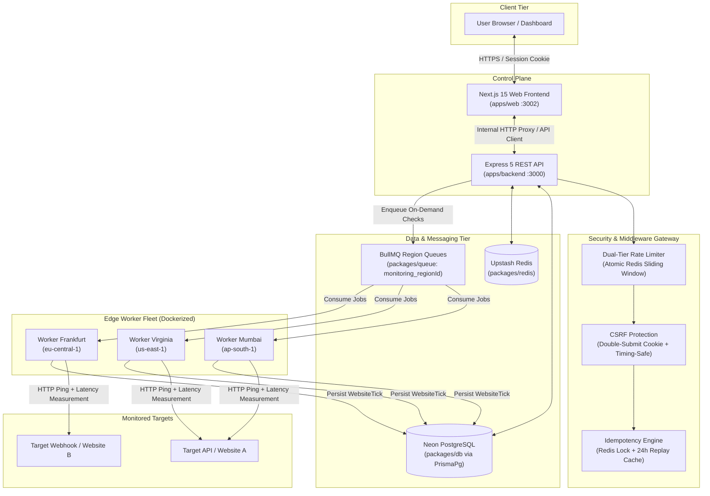
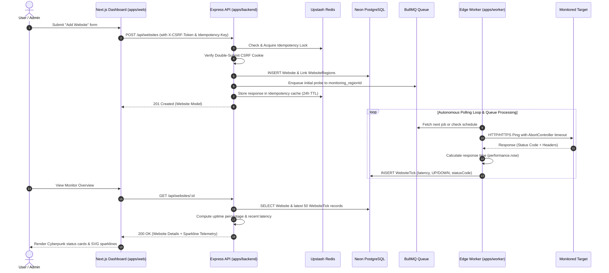

# 🗼 Watchtower

> **Distributed Multi-Region Synthetic Uptime & Performance Monitoring Platform**

[](https://www.typescriptlang.org/)
[](https://turbo.build/)
[](https://nextjs.org/)
[](https://expressjs.com/)
[](https://www.prisma.io/)
[](https://bullmq.io/)
[](https://www.docker.com/)

**Watchtower** is an enterprise-grade synthetic monitoring platform engineered to detect downtime, track latency degradation, and verify global endpoint availability in real time. It decouples the control plane (management dashboard & REST API) from an autonomous, multi-region data plane of containerized edge probe workers distributed across geographic zones.

---

## 🏛️ System Design & Architecture

Watchtower is structured as an optimized TypeScript monorepo orchestrated with **Turborepo** and **pnpm workspaces**. The system strictly separates concerns into a high-throughput **Control Plane**, a resilient **Messaging & Persistence Tier**, and an autonomous **Edge Worker Fleet**.

### High-Level Architecture



---

### End-to-End Probe & Telemetry Lifecycle



---

## 📦 Monorepo Workspace Structure

```
watchtower/
├── apps/
│   ├── backend/                 # Express 5 REST API (Auth, Websites, Security Middlewares)
│   ├── web/                     # Next.js 15 App Router Frontend (Cyberpunk Dashboard UI)
│   ├── worker/                  # Multi-region Docker edge monitoring worker service
│   ├── docs/                    # Architecture and documentation site
│   └── tests/                   # Monorepo integration and end-to-end tests
├── packages/
│   ├── db/                      # Prisma ORM schema, migrations & Neon connection pool adapter
│   ├── queue/                   # BullMQ job queue definitions, connection factory & consumers
│   ├── redis/                   # Singleton Upstash Redis client with TLS
│   ├── ui/                      # Shared React UI components & Tailwind configuration
│   ├── typescript-config/       # Centralized TypeScript configuration presets
│   └── eslint-config/           # Centralized ESLint rulesets
├── docker-compose.workers.yml    # Multi-region Docker orchestration for edge worker fleet
├── pnpm-workspace.yaml          # Monorepo workspace mapping
└── turbo.json                   # Turborepo task pipeline definitions
```

---

## ⚡ Key Features

- **Multi-Region Distributed Probing**: Probes endpoints from distinct geographical zones (`ap-south-1` Mumbai, `us-east-1` Virginia, `eu-central-1` Frankfurt) to pinpoint localized CDN/routing failures.
- **Autonomous & Queued Check Execution**: Dual-mode execution engine combining a persistent autonomous scheduler (scans active targets every `N` seconds) with on-demand BullMQ queue consumers.
- **High-Resolution Telemetry**: Captures raw `WebsiteTick` records with sub-millisecond precision (`performance.now()`), tracking status codes, response times, and failure reasons.
- **Dynamic Metric Computation**: Dynamic calculation of rolling uptime percentages and latency averages without blocking ingestion threads.
- **Cyberpunk Dark-Mode Interface**: Next.js 15 App Router dashboard with SVG sparklines, status pulse badges, region breakdown tables, and interactive uptime timeline segments.

---

## 🛡️ Enterprise Security Suite

Watchtower integrates a defense-in-depth security layer built directly into [`apps/backend`](file:///d:/Programs/Github/watchtower/apps/backend):

| Security Module             | Implementation Mechanism                                                                                                                                                                                              | Threat Mitigation                                                                              |
| :-------------------------- | :-------------------------------------------------------------------------------------------------------------------------------------------------------------------------------------------------------------------- | :--------------------------------------------------------------------------------------------- |
| **CSRF Protection**         | Double-submit cookie pattern (`csrfToken`), 32-byte cryptographic entropy, validated with `crypto.timingSafeEqual` against `X-CSRF-Token`. Automatic cookie issuance on `GET` and token endpoint (`/api/csrf-token`). | Cross-Site Request Forgery across mutating actions (`POST`, `PUT`, `DELETE`).                  |
| **Distributed Idempotency** | Redis-backed distributed locks (60s in-flight mutex) and response caching (24h TTL) keyed by `Idempotency-Key` and user scope.                                                                                        | Duplicate transactions, double-charges, replayed form submissions during network retry spikes. |
| **Dual-Tier Rate Limiting** | Atomic Redis sliding window counters (`INCR` + `EXPIRE`). Auth routes: **10 req/min**; Global API: **120 req/min**. Fully standard-compliant headers (`X-RateLimit-*`, `Retry-After`).                                | Credential stuffing, brute-force attacks, email bombing, and volumetric DoS.                   |
| **Password Security**       | Argon2id hashing algorithm with cryptographic salting and constant-time password verification.                                                                                                                        | Database credential dumps and rainbow table attacks.                                           |
| **Fail-Open Resilience**    | Graceful fallback when Redis encounters connection transients to prevent catastrophic control plane outages.                                                                                                          | Infrastructure single-point-of-failure bottlenecks.                                            |

---

## 🧩 Design Patterns Applied

1. **Singleton Pattern**: Managed lifecycle for Prisma DB Client (`packages/db`) and Redis Client (`packages/redis`) with `globalThis` caching to eliminate connection leaks across hot-reloads.
2. **Producer-Consumer Pattern**: Control plane acts as producer pushing check tasks to BullMQ region queues; containerized edge workers act as decoupled consumers.
3. **Double-Submit Cookie Pattern**: Stateless cryptographic token cross-referenced between HTTP-only / readable cookies and headers.
4. **Cache-Aside & Mutex Locking**: Idempotency middleware intercepts requests, checks Redis cache, acquires distributed lock, executes handler, and caches result.
5. **Adapter Pattern**: `@prisma/adapter-pg` wraps serverless Neon PostgreSQL connection pooling behind the uniform Prisma query engine interface.
6. **Middleware Pipeline Pattern**: Express 5 composable filters cleanly separating authentication, rate limiting, CSRF verification, and idempotency from core business logic.

---

## 🚀 Getting Started

### Prerequisites

- **Node.js**: `v22.x` or `v24.x`
- **pnpm**: `v10.x` or `v11.x` (`corepack enable pnpm`)
- **Docker**: For deploying edge monitoring worker containers
- **PostgreSQL**: Managed instance (e.g., [Neon](https://neon.tech))
- **Redis**: Managed instance with TLS (e.g., [Upstash](https://upstash.com))

### 1. Clone & Install Dependencies

```bash
git clone https://github.com/abhilov23/watchtower.git
cd watchtower
pnpm install
```

### 2. Environment Configuration

Create `.env` in the root workspace or in respective app folders:

```env
# Database (Neon PostgreSQL)
DATABASE_URL="postgresql://<user>:<password>@<host>/<database>?sslmode=require"

# Cache & Queues (Upstash Redis)
REDIS_URL="rediss://default:<password>@<host>:6379"

# Resend Email Integration (Optional)
RESEND_API_KEY="re_..."
EMAIL_FROM="Watchtower Alerts <alerts@yourdomain.com>"

# App Ports & URLs
PORT=3000
FRONTEND_URL="http://localhost:3002"
```

### 3. Database Migration & Seeding

Sync the Prisma schema to your PostgreSQL database and seed supported regions:

```bash
# Push schema migrations
pnpm --filter @watchtower/db db:push

# Generate Prisma Client
pnpm --filter @watchtower/db generate
```

### 4. Run Development Environment

Start all applications and packages concurrently with Turborepo:

```bash
pnpm run dev
```

- **Web Dashboard**: [http://localhost:3002](http://localhost:3002)
- **Express REST API**: [http://localhost:3000](http://localhost:3000)

---

## 🐳 Multi-Region Docker Worker Deployment

The edge monitoring worker in [`apps/worker`](file:///d:/Programs/Github/watchtower/apps/worker) is containerized with a lightweight multi-stage Alpine Dockerfile.

To launch multiple regional workers simultaneously:

```bash
docker compose -f docker-compose.workers.yml up -d --build
```

### Deployed Regional Nodes

| Container Name                | Region Code    | Geographical Location   | Environment Flag           |
| :---------------------------- | :------------- | :---------------------- | :------------------------- |
| `watchtower-worker-mumbai`    | `ap-south-1`   | Mumbai, India           | `REGION_CODE=ap-south-1`   |
| `watchtower-worker-virginia`  | `us-east-1`    | Virginia, United States | `REGION_CODE=us-east-1`    |
| `watchtower-worker-frankfurt` | `eu-central-1` | Frankfurt, Germany      | `REGION_CODE=eu-central-1` |

Inspect live worker telemetry logs:

```bash
docker logs -f watchtower-worker-mumbai
```

---

## 🛠️ Monorepo CLI Commands

| Command                | Action                                                                     |
| :--------------------- | :------------------------------------------------------------------------- |
| `pnpm run dev`         | Launch all apps (`web`, `backend`, `worker`) in development mode via Turbo |
| `pnpm run build`       | Build all packages and applications for production                         |
| `pnpm run check-types` | Run static TypeScript checks across all monorepo packages                  |
| `pnpm run lint`        | Run ESLint validation across the repository                                |
| `pnpm run format`      | Auto-format all TypeScript, TSX, and Markdown files with Prettier          |

---

## 📄 License

This project is licensed under the MIT License.
